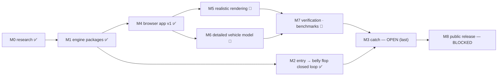
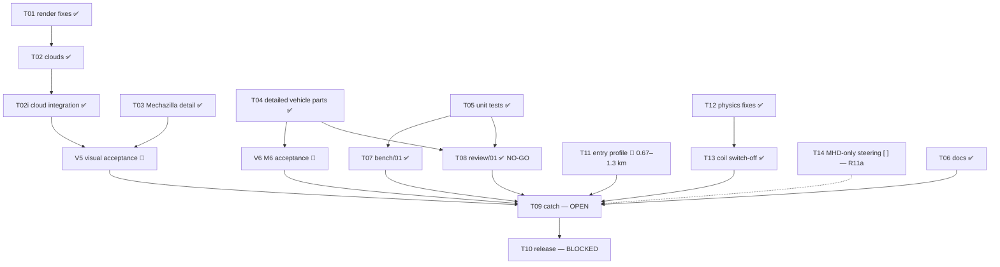

# plan/00 — Roadmap, task graph and work breakdown

Status legend: `[x]` done and verified · `[~]` in progress / implemented but not yet fully
verified · `[ ]` open. Every `[x]` names its evidence (test, script, screenshot or journal entry).
The roadmap is checked and updated at the end of every work session (user, 2026-11-21).

## Current status — 2026-11-22

**The catch is achieved in still air; M3 is closed for the no-wind case only. M8 is still blocked.**

The full closed-loop mission (`bun scripts/snapshot.ts`, no wind) now ends `caught`: the arms are
**closed**, both pins carry the load, and the engines are cut at contact (`offset 0.03 m`,
5.0 t of landing propellant left; the flip is complete 1205 m up and the pins are 2.5 m from the
axis at the 1 km gate). The earlier `CAUGHT` was a false catch (arms open,
12.8 m off) and stays retracted.

**With the default wind the mission still ends `lost`** (delivery ≈ 550–700 m off; the descent runs
out of propellant ≈ 5 m above the rails). The all-weather release, the TPS bondline and T‑mc remain
open.

| Area | Current state | Evidence |
|---|---|---|
| **M3 — catch** | **CAUGHT in still air; windy open.** | No-wind full mission (2026-11-23): flip-and-stop complete 1205 m above the rails, pins 2.5 m from the axis at the 1 km gate, vertical fall and hoverslam, `caught` with 0.03 m offset (pins touch at ≈ 0.7 m/s, engine cut on contact, arms locked, 4.7 cm of sag on the rails), 5.0 t of landing propellant left, 25–28 s of compute. Tuned point: 5 of 12 neighbouring tunings of the entry aim/gate deliver inside the belly flop's reach — the high-α hand-over is the open robustness item. Roll on the cold-gas couples during the single-engine descent (deviation from Raptors-only). Evidence: `docs/03-spec/flight/nowind/flight.md`, `scripts/verify-model.ts`, `scripts/gate-check.ts`. |
| **TPS** | **Over the LI-900 limits.** | Latest sweeps: tile **1650 K** vs 1530 K, bondline **695 K** vs 560 K, backing 363 K (pass); `.tmp/review/gate150*.log`, `smooth.log`. Integrated run: tile 1684 K, bondline 701 K (`.tmp/mission_verify.log`). The sourced SpaceX tile claim is 1673 K; the design uses the conservative LI-900 1530 K limit. |
| **T‑mc** | **Not run.** | No Monte Carlo ensemble exists; a nominal catch would not close T09 anyway. |
| **Typecheck** | Clean. | `bun run typecheck`, 2026-11-21. |
| **Tests** | 324 pass, 2 todo, 0 fail, 30 files. | `bun test packages`, 2026-11-22. The two todos are the stale aero subsonic-trim and belly-flop terminal-velocity numbers. |
| **Tower collision** | Done and tested. | `packages/tower/src/tower.ts` `towerContact`; `packages/sim/src/step.ts` enables contact in every phase within 260 m altitude / 300 m of the pad; `packages/tower/test/tower.test.ts` 11 pass (column push-out, arm-top support, closing-arm squeeze, pin friction). |
| **Arm timing** | Done. | `guidance.ts`: closes on time-to-rails with `armCloseLead = 3.7 s`, predicted closure position and the tuning's lateral/along limits; review/02 §5. Not yet exercised by a successful catch. |
| **Direction gates** | Done. | `landing.ts` `pRefH = [0, −12]` (south gate); terminal requires `y < 5` and `v_y > −0.5`; catch requires `v_y > 0` and `abs(v_x) < 0.8`; review/02 §"Direction gates". The gates reject wrong arrivals; they did not produce a catch. |
| **Right-mouse pan** | Done. | `packages/view/src/index.ts`: `OrbitControls` `RIGHT: PAN`, screen-space panning, context menu suppressed, target persists across frames until Fit/Home; review/02 §5. |
| **Altitude graph** | Done. | `packages/app/index.html` `#altgraph`; `packages/app/src/main.ts` `buildAltGraph`/`drawAltGraph`; top-right, left of the ViewCube; review/02 §5. |
| **Global clouds** | Done and visually verified. | `view/src/cloudsGlobal.ts` + `view/src/clouds.ts`; `view/src/index.ts` global shell + local deck. `final.log` (400/50/30 km) and `final2.log` (5/2/0.3 km) show `global=true`; screenshots `.tmp/shots/agentC4/final-limb.png`, `horizon-h2.png`, `horizon-h5.png`. |
| **Predicted-path overlay** | Done and visually verified. | `view/src/prediction.ts`; tree toggle "Predicted path (MPC)"; `.tmp/shots/agentC4/app4-path-off.png` / `app4-path-on.png`; `app4.log`. Cyan = recorded future, pale = MPC plan; review/02 §"Why the two overlay lines differ". |
| **Release** | **Blocked.** | [spec/11 release gate](../03-spec/11-release.md); M3 + TPS + T‑mc + user approval. |

### What this means

- The deorbit → entry → high-α → belly-flop → flip → landing chain is closed and runs to the tower,
  but the final lateral null / tilt tracking does not put the pins inside the catch envelope.
- The TPS is an independent blocker: the tile surface and PICA-X bondline are over their limits even
  when the landing would otherwise close.
- The UI/rendering features above are complete; they do not compensate for the missing catch.
- **M3 and M8 are intentionally not ticked.** Do not mark either as done until the release gate in
  spec/11 is satisfied.

## Fast iteration (T17, 2026-11-21)

The edit loop is **module-first**. A local change must be proven by the owning package test or the
controller bench; the full 6-DOF mission is the integration/release gate, not the inner loop. See
`docs/03-spec/12-testability.md`.

- [x] `bash scripts/quick-check.sh` — tower contact, gnc landing/guidance, score, MPC/model bench; no full mission.
- [x] `bun scripts/mpc-bench.ts` — PD+FF / ZEM-ZEV / two-phase MPC / PDG / open-loop / bang-bang on
      one real thrust/mass/gimbal plant; 17/17 model checks exact.
- [x] Synthetic score fixtures (rail-plane crossing) and tower contact fixtures; no entry run.
- [~] Catch-only sub-second harness beyond the tower/landing unit tests (the contact worker is adding
      the direct “drive a hull into the tower” test).
- [x] Full mission is documented as tier 3 / release only; not required for docs/UI/local edits.

## Release checklist (blocked)

- [ ] M3: true catch — `armsClose`, pin load, ±1 m of the centreline, ≤ 1 m/s contact, arrival from
      the south/northward, with wind.
- [ ] TPS: tile ≤ 1530 K, bondline ≤ 560 K, backing ≤ 600 K, steel ≤ 1150 K on the released run.
- [ ] T‑mc: ≥ 18/20 caught with wind, κ, B and mass ±5 %.
- [ ] R11a: cold-gas use during the coil phase reported and within the fallback policy.
- [ ] R11b: coil discharged at the real switch-off time; current at touchdown reported.
- [ ] `bun run typecheck` clean; `bun run test` green; unresolved `test.todo` items accepted or closed.
- [ ] `bun run build` succeeds; Pages workflow green on a test branch; public URL screenshot verified.
- [ ] User explicitly approves the public repository, Pages deployment and release wording.
- [ ] README, roadmap, spec/04, spec/05 and spec/11 updated to the released outcome.

## Order of work (user, 2026-11-21)

The catch (M3) is done **last**. First everything else is fully implemented and working:
M6/M5 (detailed vehicle, realistic rendering, wind arrows) → M7 (tests, benchmarks, review) →
M3 (catch: flip + landing, terminal, arms) → M8 (public release, after user approval).

## Milestones

| ID | Milestone | Exit criteria | Status |
|---|---|---|---|
| M0 | Research & feasibility | research/01–05; every number sourced, computed or assumed | ✅ |
| M1 | Engine packages | 12 packages, `bun run typecheck` clean, pure step function | ✅ |
| M2 | Closed loop to the belly flop | footprint centre within the belly reach; steel < 1150 K, bondline < 560 K, no quench | ✅ at the M2 design point (≈ 1 km); the current 144 t run is outside the TPS limits — see spec/11 §3.2 |
| M3 | Flip, landing burn, terminal, catch | outcome `caught`; pins on the rails < 1 m; ≥ 1 t propellant left | 🔄 **OPEN (last)** — no true catch |
| M4 | Browser app v1 | worker-first run, Fusion-style UI (spec/04 A0–A3), Playwright screenshots | ✅ |
| M5 | Realistic rendering | spec/04 A4: sky, Earth, clouds, coast, ocean, tower, plasma, plumes, wind arrows, no flicker | 🔄 **mostly done** — global clouds verified; plasma/plume/puff visual re-checks remain |
| M6 | Detailed vehicle | spec/07 assembly tree: every part modelled, rendered, in the browser tree | 🔄 **41/41 parts built** — exploded-view acceptance pending |
| M7 | Verification & benchmarks | spec/05 test matrix green; bench/01; review/01 adversarial review closed | 🔄 tests green (2 todo); bench/01 done; review/01 NO-GO, review/02 written; T09 open |
| M8 | Public release | repo via `gh`, Pages workflow green, public URL verified | ⬜ **BLOCKED** — after M3, TPS, T‑mc and user approval |

## M3 — terminal flight and catch (open)

Done and verified:

- [x] Planned-reversal high-α law (E17–E19) — journal 2026-11-20.
- [x] Physical lift-transport model in predictor and command (E20+).
- [x] Belly flop: σ → ψ hybrid, catch-roll alignment, flip azimuth toward the tower.
- [x] Ground contact ends the run at the lowest hull point (no sinking through the ground) — 2026-11-21.
- [x] Landing MPC (TS-02) integrated, smooth — 2026-11-21.
- [x] Per-axis time-optimal attitude limits, roll-priority gimbal allocation (TS-01).
- [x] Flip hand-over on near-zero sink rate (no climb).
- [x] Landing-engine selection by ZEM direction (TS-12).
- [x] Engine count study: 3 for flip/deceleration, 1 for the approach; later changed to **2 Raptors
      from flip ignition to the pins** (R11c/Q29/Q33) — `bench/02` constraints `landingEngines:ok`,
      `noColdGasAfterFlip:ok`.
- [x] Lag-aware MPC model (thrust pointing τ) — `packages/gnc/test/mpc.test.ts` (miss 1.8 m vs 5.2 m
      τ-blind).
- [x] Solid tower/arm collision (column, carriage, arm tops/tips, mount) in every phase near the pad
      — `tower/src/tower.ts`, `sim/src/step.ts`, `tower/test/tower.test.ts` 11 pass.
- [x] Arm timing by time-to-rails with the predicted closure position — `guidance.ts`,
      `armCloseLead = 3.7 s`; review/02 §5.
- [x] Approach-direction gates: south divert gate, northward terminal, `v_y > 0`, `|v_x| < 0.8` for a
      catch — `guidance.ts`, `landing.ts`; review/02.
- [x] Anisotropic catch cost (`wX 4 / wY 0.35`), terminal centreline path export, vertical trim
      applied — review/02 §5.
- [x] Right-mouse pan, transparent altitude graph, predicted-path overlay — review/02 §5; see the
      verified-capabilities table above.
- [x] Global cloud shell + local volumetric deck — `final.log`, `final2.log`, C4 screenshots.
- [x] Coil switch-off/discharge (Q25/Q32): dynamic authority switch-off, 1 Ω / 3 kV planned
      discharge; `mission_verify.log` discharge at T+2802.2 s, authority 0.00.
- [x] R11c: no cold gas after the flip; two SL Raptors with differential gimbal — `guidance.ts`,
      `bench/02` constraints.

Still open (these keep M3 open):

- [ ] **True catch**: the pins must settle on the rails with `armsClose`, ≤ 1 m lateral, ≤ 1 m/s,
      northward. Current runs are `lost`. The code currently gates on **total** pin load; a per-pin
      check (both pins individually on a rail) is still open (spec/11 §3.1).
- [ ] Landing lateral controller: the two-phase plan still commands a tilt reversal near the pad that
      the body cannot follow; the body's 7–12° tilt lag costs the lateral authority. Next: joint 3-D
      rate-limited PDG including the attitude state, or a closer belly-flop delivery.
- [ ] Belly-flop delivery < 500 m at the flip. Current entry/hand-over is 674–702 m at the 2.0 km gate
      (`.tmp/mission_verify.log`, journal 2026-11-21); agent G's honest entry is 1307 m at the earlier
      gate.
- [ ] TPS within limits: tile ≤ 1530 K, bondline ≤ 560 K (see spec/11 §3.2; Q21/Q30).
- [ ] T‑mc: ≥ 18/20 caught with wind, κ, B, mass ±5 %. **Not run.**

## Verified UI / rendering capabilities (2026-11-21)

These are done and should not be re-opened as roadmap gaps. Their evidence is code plus the named
run logs/screenshots; they are not a substitute for the missing catch.

| Capability | Where | Verification |
|---|---|---|
| Tower collision | `tower/src/tower.ts`, `sim/src/step.ts` | 11 tower tests pass; contact independent of guidance phase within 260 m / 300 m of the pad. |
| Arm timing | `gnc/src/guidance.ts` | `armCloseLead` 3.7 s, predicted closure point, tuning's lateral/along limits; review/02 §5. |
| Direction gates | `gnc/src/guidance.ts`, `gnc/src/landing.ts` | South gate `[0, −12]`; terminal `y < 5`, `v_y > −0.5`; catch `v_y > 0`, `abs(v_x) < 0.8`; review/02. |
| Right-mouse pan | `view/src/index.ts` | `OrbitControls` RIGHT = PAN, screen-space panning, context menu suppressed, target persists. |
| Altitude graph | `app/index.html`, `app/src/main.ts` | Transparent canvas top-right; altitude vs time, phase colour, live marker; review/02 §5. |
| Global clouds | `view/src/cloudsGlobal.ts`, `view/src/clouds.ts`, `view/src/index.ts` | `final.log` (400/50/30 km), `final2.log` (5/2/0.3 km), screenshots `.tmp/shots/agentC4/`. |
| Predicted-path overlay | `view/src/prediction.ts` | Tree toggle; `app4-path-off.png` / `app4-path-on.png`; review/02 §"Why the two overlay lines differ". |

## Task graph

## Task table

| Task | Owner | Owns (files) | Depends on | Status |
|---|---|---|---|---|
| T01 render fixes | orchestrator | `view/src/env.ts`, `view/src/index.ts`, `view/src/fx.ts`, `view/src/ship.ts` | – | [x] tsc clean; flicker re-check in V5 |
| T02 volumetric clouds | agent A, relaunched | `view/src/clouds.ts`, `app/dev/clouds*` | – | [x] integrated; global shell + local deck verified (C4 logs) |
| T02i cloud integration | orchestrator | `view/src/index.ts` | T01, T02 | [x] `final.log` / `final2.log`, C4 screenshots |
| T03 Mechazilla detail | agent B | `view/src/tower.ts`, `app/dev/pad*` | – | [x] 59 k triangles; arm positions equal the contact geometry; integrated 2026-11-21 |
| T04 vehicle parts | agent C | `view/src/parts.ts`, `view/src/parts/*`, `app/dev/ship*` | spec/07 | [x] 41 of 41 part rows built; departures in spec/07 §4 |
| T05 unit tests | agent D | `packages/*/test/*.test.ts` | – | [x] 238 pass, 2 todo, 0 fail, 22 files (2026-11-21) |
| T06 docs | orchestrator | `docs/**` | – | [x] roadmap/README/release current; journal close-out 2026-11-21 |
| T07 bench/01 | agent B2 | `docs/05-benchmarks/01-*.md`, `scripts/bench.ts` | T05 | [x] 35.4 s (72,148 steps; entry + high-α 77.7 %); G4 ≤ 30 s not met in Bun |
| T08 review/01 | agent R | `docs/04-review/01-adversarial-physics.md` | T04, T05 | [x] T09 NO-GO; R6/R11c fixed, R11a partial; review/02 written |
| T09 catch | orchestrator | `packages/gnc/**` | V5, V6, T06–T08 | [ ] **open — no true catch** |
| T10 release | orchestrator | `.github/**` | T09, TPS, T‑mc, user approval | [ ] **blocked** |
| T11 entry profile | agent E/G | `gnc/src/guidance.ts`, `gnc/src/predictor.ts`, `gnc/src/plan.ts`, `scripts/profile.ts` | – | [~] honest entry 1307 m; 674–702 m at the 2.0 km gate; < 500 m not met |
| T12 physics bug fixes | agent F | `heat/src/thermal.ts`, `mhd/src/coil.ts`, `craft/src/config.ts`, `tower/src/tower.ts`, `gnc/src/control.ts`, `sim/src/step.ts`, tests | T05 | [x] fixed and tested; new findings Q19–Q21 |
| T13 coil switch-off (R11b) | agent E/C2 | `gnc/src/guidance.ts`, `mhd/src/coil.ts` | T11, T14 | [x] authority switch-off + Q32 discharge; `mission_verify.log` discharge T+2802.2 s |
| T14 MHD-only steering incl. roll (R11a) | agent E | `gnc/src/guidance.ts`, `gnc/src/mhdAlloc.ts` | T11 | [ ] cold-gas fallback still open |
| T15 recording cache | orchestrator | `app/vite.config.ts`, `app/src/simCache.ts`, `app/src/main.ts`, `app/index.html` | – | [~] implemented; reload verification pending |
| T16 integrate T03 + T04 | orchestrator | `view/src/ship.ts`, `view/src/env.ts`, `view/src/index.ts`, `tower/src/tower.ts` | T03, T04 | [x] typecheck clean; visual check in V5/V6 |
| T17 modular fast iteration | orchestrator | `docs/03-spec/12-testability.md`, `scripts/quick-check.sh`, `scripts/mpc-bench.ts` | – | [x] tier 0–1 gate + catch/guidance/thrust/score map; full mission is integration only |

## M5 — realistic rendering (spec/04 A4)

- [x] Studio / physical-sky toggle, ViewCube, crisp text (DPR) — 2026-11-21.
- [x] Physical sky (Preetham, three/addons Sky) with the true Sun position, **default on**, altitude
      fade e^{−h/8 km} — `.tmp/shots/r-0.62.png`.
- [x] Photorealistic Earth: Blue Marble day + Black Marble 2016 night lights (public domain, bundled,
      `textures/CREDITS.md`) — `r-0.62.png`.
- [x] Single-scattering atmosphere (Rayleigh + Mie, Earth shadow), correct from inside and outside —
      limb and sunset band in `r-0.05.png`.
- [x] Eclipse: direct sunlight × visible fraction of the solar disc behind the Earth's limb.
- [x] Image-based lighting (PMREM of the sky; RoomEnvironment in studio) — steel reflects.
- [x] Bloom limited to emitters (HDR threshold 2.5) — veil removed (`q-0.975.png`).
- [x] **Global cloud shell + local volumetric cumulus deck** — `final.log`, `final2.log`, C4
      screenshots at 400/50/30/5/2/0.3 km; the local deck fades into the global shell.
- [x] Predicted-path overlay, right-mouse pan, altitude graph — see the verified-capabilities table.
- [~] Starbase coast: scrub, beach, Gulf water shader; distance anti-aliasing of short waves (moiré) —
      re-check in V5.
- [~] Plasma: windward-weighted shock-layer emission (Newtonian sin²θ), black-body T₀, n_e brightness,
      wake, light — re-check in V5.
- [~] Bow shock overlays: Δ (Fresnel shell) and Δ₀ (dashed), Billig cap — re-check in V5.
- [~] Methalox plume shader rewritten (column depth, shock cells, no 30 Hz flicker) — T01, re-check in V5.
- [~] Wind arrow field (ANSYS rainbow, legend, readable ≥ 4 m/s range) — T01.
- [~] Flicker-free descent — T01: plume flicker removed (white pixels 3 % → < 0.6 %), flat sky clouds
      removed, env map finely quantised, stars fade; **one sky model** (single scattering at every
      altitude, Sun disc in it) removed the 15 km sky jump (163 → 133 luminance step gone); coast planes
      300 km fading over the Earth (25–45 km, 60–100 km range); wind arrows fade in below 40 km.
- [x] Detailed Mechazilla, Pad 2 (T03): lattice, crown, carriage, chopsticks at the contact geometry,
      ship QD arm, launch mount with flame trench, tank farm; 59 k triangles.

M5 overall remains `[~]`: the cloud/coast/UI work is done, but the plasma/plume/bow-shock visual
acceptance was not re-captured after the last reload loop.

## M6 — detailed vehicle (spec/07)

- [x] OML corrected to 21 rings × 1.83 m + 13.67 m nosecone (research/05).
- [x] Pins moved into the nosecone base (chopstick lift points).
- [x] spec/07 CAD assembly tree, part table, materials, LOD budget — `docs/03-spec/07-cad-model.md`.
- [x] Weld seams proud of the hull (no dashed z-fighting) — `zoom1.png` before/after.
- [x] Parts first pass (`view/src/parts.ts`): skirt shields, vents, puck, domes, PEZ, frames, raceway,
      tanks, downcomers, headers, COPVs, pods, cryostat, coolers, converter, battery, Cs tank, avionics,
      Starlink — 41 of 41 rows built.
- [x] Raptor 3 SL / RVac detailed (T04): powerhead, two turbopumps, preburners, injector, regenerative
      nozzle with channel ribs, TVC actuators.
- [x] PICA-X honeycomb: colour, normal and roughness maps and geometry at real scale, nosecone only (T04).
- [x] All spec/07 rows built (T04); departures from the table are listed in spec/07 §4.
- [~] M6 acceptance (browser tree + exploded view) — visual check pending.

## M7 — verification & benchmarks

- [x] `packages/*/test` per spec/05 — 22 files, 238 pass, 2 todo, 0 fail (`bun test packages`, 2026-11-21).
- [~] Two todos remain: aero subsonic trim band and terminal velocity (stale spec numbers, see spec/05
      and spec/02).
- [x] bench/01 run time per phase — 35.4 s (72,148 steps; entry + high-α 77.7 %); G4 ≤ 30 s not met in
      Bun. The later integrated run in `mission_verify.log` measured 27.5 s, but G4 is a browser-worker
      target and has not been re-measured for a caught mission.
- [x] review/01 adversarial physics review — NO-GO; R6/R11c fixed, R11a partial; review/02 written.
- [ ] T09 gate: delivery < 500 m; ≥ 2 SL Raptors with a test; R6/R9 channels removed; R11a cold gas
      reported; coil current reported; tile re-flown under limits; header re-sized.
- [ ] T‑mc ≥ 18/20.

## M8 — release

- [ ] User approval for a public repository.
- [ ] `gh repo create`, push, `.github/workflows/pages.yml`, Pages URL verified with a screenshot.
- [ ] Release gate: [spec/11](../03-spec/11-release.md) R‑1…R‑7.

## Run rules (2026-11-21, from the restart analysis)

Heavy runs follow `docs/05-benchmarks/00-machine-budget.md`: `nice -n 19`, one mission or profile run
at a time, one headless browser at a time. The OpenCode server restarts when the CPU starves it.

## Environment finding (2026-11-21, 11:49 UTC)

The restart loop was CPU, not memory: load 20.0 on 12 vCPU, CPU pressure 37.7 %, 30 GB free, OOM 0.
Five `rea mcp` processes (one per project directory, ~355 MB and 27–31 % CPU each) plus the
software-rendered verification Chromium (~5 cores) saturated the box; the CLI declared "Event stream
stalled" every 80–90 s and restarted `opencode serve`. Closing Chromium dropped the load to 5.2 and CPU
pressure to 1 %; the server then stayed up for 3+ minutes. The 838 MB session DB remains a secondary
event-loop risk (I/O PSI 0.6 %). Structural fix still needs approval: restrict `rea` to one project,
archive old sessions.

## Historical snapshots (dated; not current status)

### 2026-11-20 — research and first closed loop

- Research/01–05: Flight 15, TPS materials, MHD/HTS, flapless feasibility, geometry.
- M1 engine packages and M2 closed loop to the belly flop; the literal "nose-first all the way, flip
  near the ground" concept is infeasible, and the physical variant (MHD nose-first glide → pitch-up →
  high-α → belly flop → flip) is adopted.

### 2026-11-21, fourth round — tiles, coil switch-off, mass

- Q23 tiles: `craft/src/tiles.ts` + S-10 mass item. 6.24 t (1072 m² × 5.82 kg/m²); dry **107.40 t**,
  wet **143.65 t**, x_cg 27.57 m, I = (1.65e6, 4.33e7, 4.33e7) kg m² (Cs double count fixed).
- Q23 thermal: 6-node LI-900 layer + RTV bond + lumped steel backing; `tileSurf` / `tileBack` channels;
  energy test within 0.5 %.
- Q25 coil switch-off: flight-software authority, hold ≥ 1.0, ramp-down after 3 s below 1.0 or plasma
  gone, no re-ramp; later replaced for the planned path by the Q32 1 Ω / 3 kV discharge.
- R11c cold gas after the flip: `useRcs: false` in flip/landing/terminal; the gimbal takes the full
  three-axis torque.
- Entry blocker: the 144 t vehicle at 99 m/s deorbit gave a 17.7 km flip miss; the deorbit angle was
  not the only issue.

### 2026-11-21, later — honest entry and 2-engine landing

- Agent G: passive trim at ≈ 28°, 2-axis feed-forward moment, bank freeze/dwell; flip miss **1307 m**,
  5.76 g, 25.6 kPa, Δv 105; later Δv 108 and 702 m at the 2.0 km gate. The belly-flop flare was
  rejected on physics (lift 0.4 g cannot hold the sink).
- Agent L: 2 SL Raptors, no cold gas, coil discharged, two-phase hoverslam + lateral MPC; header use
  21.55 t, 4.4 t left; gate trade 1.4 km −8.5 m/s², 1.7 km +0.7, 2.0 km +4.8; the 2.0 km gate still
  ended 186 m off because of the 7–12° tilt lag.
- False catch retracted: the old catch condition fired with the arms open, a single pin grazing a rail
  at 12.8 m off. The catch now requires `mem.armsClose`.
- Review/02 root cause: the two-phase lateral MPC has no thrust-slew model; the plan commands a large
  tilt reversal the body cannot follow. A joint 3-D rate-limited PDG is the next step; `pdg.ts` is a
  scaffold, not a claimed controller.
- Q31 plume-MHD study: rejected (≤ 2.54 kN per engine; gimbals remain the landing actuator).
- Global clouds, predicted-path overlay, right-mouse pan and the altitude graph landed and were
  visually verified (C4 logs/screenshots).

### 2026-11-21, optimisation and direction-gate sweeps

- The first optimiser search (bench/02) found no true catch. Best full-6-DOF candidate: 6.8 m lateral
  at 11.7 m/s, `lost`; the 1.88 km gate gave 2.55 m across, 5.5° roll and 1.17 m/s vertical, but 89 m
  along.
- Later direction-gate and 150 m hand-over sweeps (`.tmp/review/gate150*.log`, `smooth.log`,
  `taufast.log`, `terminal80.log`) also ended `lost`. Best lateral 153.3 m; the best across-arms
  geometry was 7.7 m across but 230.6 m along. These are tuning experiments, not a catch.
