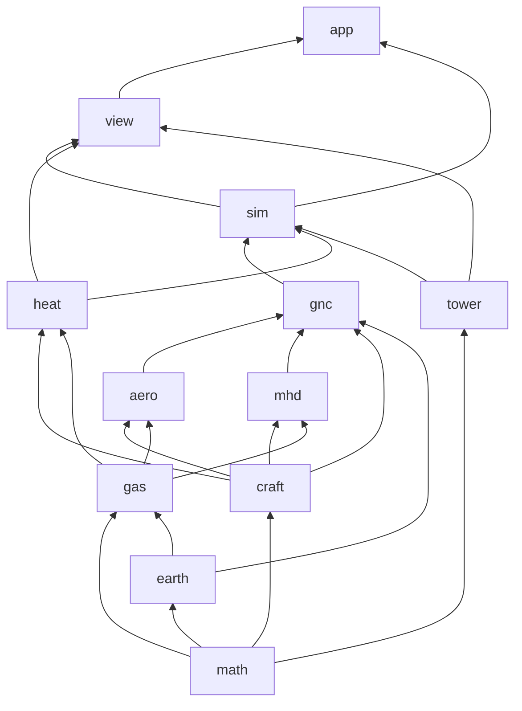
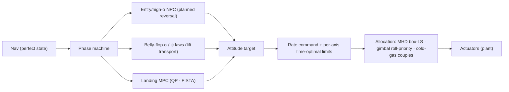

# spec/06 — System and software architecture

Status: `[x]` implemented and verified · `[~]` partial · `[ ]` open.

## 1. System context

```mermaid
flowchart LR
  U["User (browser)"] -->|loads static site| P["GitHub Pages (static files)"]
  P --> M["Main thread: @ship/app shell + @ship/view (three.js)"]
  M <-->|postMessage: run(design) / progress / recording (transferable)| W["Web Worker: @ship/sim engine"]
  W -->|pure functions| E["Domain packages: math · earth · gas · craft · aero · heat · mhd · tower · gnc"]
```

There is no server-side code at runtime. All assets are bundled; there are no CDN fetches (spec/04 A0).

## 2. Package dependency graph (Bun workspaces, isolated linker)



| Rule | Status |
|---|---|
| A package imports only declared dependencies (isolated linker makes violations fail) | [x] |
| Domain packages are pure: no DOM, no I/O, no global mutable state | [x] |
| `sim` is the only place that composes models into a step | [x] |
| `view` renders a `Recording`; it never runs physics | [x] |
| `app` owns the worker, the DOM and playback state | [x] |

## 3. Simulation core

`step: (World, SimState) → { s′, row, temps, events }` is a fold over time.

```
SimState ─┬─ environment: J2 gravity, US-76 atmosphere, winds + Dryden (earth)
          ├─ shock layer: real-gas stagnation state (gas)        ┐
          ├─ aerodynamics: panel forces/moments (aero)           │ held over
          ├─ heating + wall conduction + PICA ablation (heat)    │ the step
          ├─ MHD: B field × plasma → force/moment/power (mhd)    ┘
          ├─ navigation (perfect, I1) → guide() → commands (gnc)
          ├─ allocation: MHD electrodes → gimbals (roll-priority) → cold-gas couples (gnc)
          ├─ engines (spool/throttle/gimbal dynamics), RCS, coil circuit + cryo (craft/mhd)
          ├─ RK4 rigid body (gravity + contact evaluated per stage)
          └─ consumables, mass properties, recording row
```

| Item | Status |
|---|---|
| Fixed-step RK4, phase-dependent dt (0.5 s vacuum → 4 ms catch) (TS-06) | [x] |
| Deterministic (seeded turbulence), identical results in Bun and the browser | [x] |
| Ground contact ends the run at the lowest hull point | [x] |
| Tower contact: pin spring-dampers + hull vs arm faces | [x] |
| Thermal sub-stepping with held q_stag in the recording | [x] |

## 4. Guidance, navigation and control



Details: spec/03. Trade studies: plan/01 TS-01…TS-04, TS-12.

## 5. Worker protocol and recording

| Message | Payload | Status |
|---|---|---|
| `run` (main → worker) | `DesignParams` | [x] |
| `progress` (worker → main, ≤ 7 Hz) | stage, t, phase, altitude, fraction | [x] |
| `done` | `Recording` with transferable `Float64Array` channels + `Float32Array` heat map | [x] |
| `error` | message + stack | [x] |

Recording: ≈ 180 channels × ≈ 7 700 samples (phase-dependent sampling 2 s → 0.04 s), heat map
256 cells per sample, events, phase starts, planning path, vehicle subset. Access: `locate` (binary
search) + `valueAt` (linear interpolation), O(log n) per frame.

## 6. Rendering pipeline (`@ship/view`)

| Stage | Implementation | Status |
|---|---|---|
| Frames | local ENU at the ship (metres, floating origin) / globe (km, ECEF) | [x] |
| Depth | logarithmic depth buffer (0.5 m … 5e8 m) | [x] |
| Vehicle | lathe of the physics OML + components (exploded view, browser tree) | [x] detailed (M6: 41/41 parts); exploded-view acceptance pending |
| Heat | per-vertex incandescence from the recorded heat map | [x] |
| Plasma | additive sheath + bow shock, emission shader, wake, light | [~] A4.4 visual re-check pending |
| Sky / Earth | studio gradient + physical sky; Blue Marble day, Black Marble night, single-scattering atmosphere | [x] |
| Pad | ground, sea, detailed Mechazilla (lattice, carriage, arms, mount) | [x] T03 |
| Clouds | global cloud shell + local volumetric cumulus deck | [x] C4 `final.log` / `final2.log` |
| Wind | ANSYS-style arrow field + legend | [x] T01 |
| Predicted path | recorded future + optional MPC plan, tree toggle | [x] `prediction.ts`; review/02 |
| Post | ACES tone mapping, bloom (emitters only), shadows | [x] |
| ViewCube | separate supersampled renderer | [x] |

## 7. Performance budgets

| Budget | Target | Measured | Status |
|---|---|---|---|
| Full mission in the browser worker | ≤ 30 s | 26–28 s (headless Chromium, SwiftShader host); 10–15 s target not met | [x] |
| Full mission in Bun | ≤ 20 s | 35.4 s (bench/01, older run); 27.5 s in `.tmp/mission_verify.log` (shared CPU) | [ ] |
| Landing MPC solve | ≤ 2 ms at 20 Hz | 5.8–9.0 ms per solve at 10 Hz (bench/02) | [ ] |
| Playback | 60 fps desktop GPU | not measured on hardware (headless only) | [ ] |
| Recording transfer | zero-copy | transferables | [x] |

## 8. Build, test, deploy

| Item | Status |
|---|---|
| `bun run typecheck` (strict, noUnused*) | [x] clean 2026-11-21 |
| `bun run test` (spec/05 matrix) | [x] 238 pass, 2 todo, 0 fail, 22 files |
| `bun run dev` / `build` (Vite, relative base) | [x] dev · [x] production build verified 2026-11-21 |
| `bash scripts/quick-check.sh` (tower/gnc/score + MPC bench, tier 0–1) | [x] fast edit gate; no full mission |
| Modular test map and tiers | [x] [spec/12](12-testability.md) |
| GitHub Actions → Pages (TS-10) | [ ] blocked by spec/11 release gate |
| Headless check `.tmp/pw/shot.cjs` (Playwright-core + Chromium) | [x] |

## 9. Coding standards

Strict TypeScript; pure functions with immutable records at module boundaries; loops only inside
numeric kernels (ADR-03); no `any`; every physical constant with a unit comment; every design value
in `DEFAULT_DESIGN` traced to plan/05; every model change audited against spec/00 R1–R10 (review/00).
